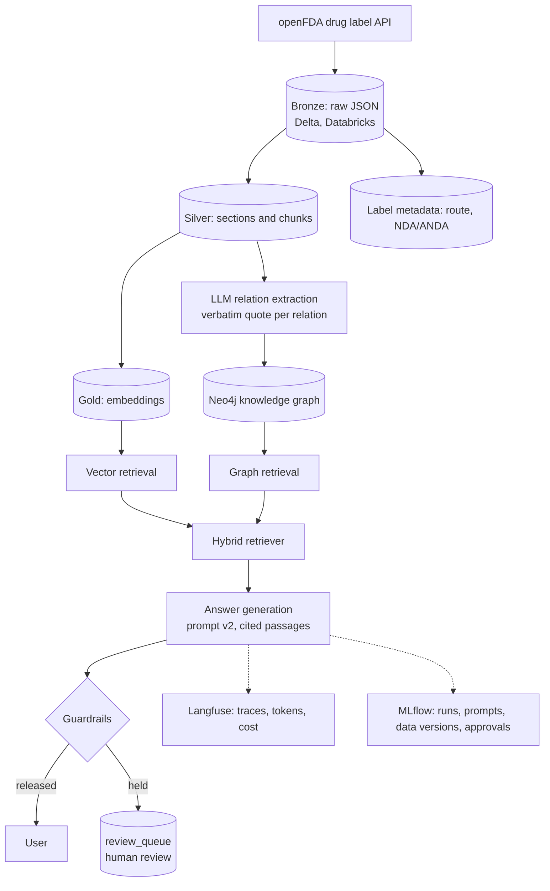

# DrugLabel QA

A question-answering assistant over official FDA drug labels (anticoagulants, antiplatelets and the drugs that interact with them) for medical information and pharmacovigilance teams, built and validated the way a GxP-regulated team would: every answer cites the label passage it comes from, unsupported or out-of-scope questions are refused, and answers that fail automated checks go to a human review queue instead of the user.

**Release v1.0.0**, validated 2026-10-17: 14/14 test cases passed against acceptance criteria approved before the run.

## At a glance

| | |
|---|---|
| Data | 261 openFDA labels of 37 drugs selected by explicit rules (WHO ATC + openFDA) → 14,131 passages in Databricks Delta tables (Bronze → Silver → Gold, every layer versioned) |
| Retrieval | Hybrid: exact vector search (bge-small) + knowledge graph in Neo4j (2,611 relations, each backed by a verbatim quote and its source passage) |
| Generation | `gpt-5.4-mini-2026-03-17`, versioned prompts; citations checked against the retrieved passages |
| Safety | Computed guardrails; held answers written to a Delta `review_queue` |
| Evaluation | 71-item golden set reviewed by a human; LLM judge (Claude Haiku 5.5, another vendor) validated at 90% agreement with blind human grades |
| Traceability | Every answer and run logged in MLflow (commit, prompt hash, data versions, model) and traced in Langfuse (latency, tokens, cost); requirements → tests → runs in a traceability matrix |

**Headline results (released configuration, golden set):** 97% of claims supported by the passage they cite, 100% valid citations, gold passage found for 98% of questions, 100% correct refusals, 2% false refusals, and **no released answer judged incorrect**: every incorrect answer was held for review. Hybrid retrieval beat vector-only (0% fully correct multi-hop answers) and graph-only (37% false refusals). Details in [Results](#results).

**Worth a look:** the [validation pack](validation/) and the first release run the gate **rejected** ([Validation](#validation)); a human reviewer's catch that became a golden-set correction ([Evaluation](#evaluation)); a [root cause analysis](#root-cause-analysis-a-false-refusal) where two plausible fixes were tested and rejected before the real cause was found.

## Architecture



Databricks Free Edition hosts the data layers, the review queue and MLflow; retrieval, generation and evaluation run locally against a parquet snapshot of Gold (no vector database needed at this size; see [Chunking and retrieval design](#chunking-and-retrieval-design)).

## Results

Golden set 1.1, 71 items (46 answerable, 11 unanswerable, 14 paraphrases). Rates for correctness, faithfulness and citations are over the 46 answerable originals; refusal rate over the 11 unanswerable. One run per configuration; per-question results in [`data/eval/`](data/eval/), one MLflow run per configuration.

| Metric | vector v1 | vector v2 | graph v1 | graph v2 | hybrid v1 | **hybrid v2** |
|---|---|---|---|---|---|---|
| Correct (all key facts) | 28% | 30% | 26% | 30% | 39% | **41%** |
| Correct or partial | 83% | 80% | 48% | 43% | 78% | **83%** |
| Faithfulness | 94% | 95% | 93% | 94% | 93% | **97%** |
| Citation validity | 96% | **100%** | 96% | **100%** | 93% | **100%** |
| Cites a gold passage | 83% | 85% | 50% | 50% | 87% | **96%** |
| Retrieval hit | 91% | 91% | 52% | 52% | **98%** | **98%** |
| False refusals | 7% | 7% | 37% | 37% | **2%** | **2%** |
| Correct refusals | 100% | 100% | 100% | 100% | 100% | 100% |
| Multi-hop correct | 0% | 0% | 17% | **33%** | 28% | 28% |
| Robustness (paraphrases) | 79% | 71% | 71% | 64% | 71% | **86%** |
| Latency p50 | 1.16 s | 0.90 s | 1.00 s | 0.80 s | 1.04 s | 0.84 s |
| Cost per question | $0.0015 | $0.0012 | $0.0015 | $0.0012 | $0.0025 | $0.0020 |

Consistency over 3 repeats (hybrid): **83%** with prompt v2, 85% with v1 (same status and correctness in all three runs; the generator is not fully deterministic at temperature 0, and inconsistent items are mostly multi-hop).

**Findings**
- **Hybrid retrieval with prompt v2 is the released configuration.** It finds a gold passage for 98% of questions, cites one in 96% of answers, has 100% valid citations, 97% of claims supported by their cited passage, 2% false refusals and 100% correct refusals, at about $0.002 per question.
- **Vector and graph retrieval are complementary.** Vector retrieval answers no multi-hop question fully (its 5 passages rarely span the labels involved); graph retrieval alone refuses 37% of answerable questions, because dosing or pharmacokinetics questions name no entity or relation it models. Combined, they do better than either on almost every metric.
- **Prompt v2 fixed the citation failure it was written for:** numbering passages raised citation validity from 93–96% to 100% in every mode, with lower latency and cost.
- **"Correct" is strict:** an answer that misses one key fact is "partial". With hybrid v2, 19 of the 46 answers are correct, 19 partial (mostly single-fact answers missing a detail), 7 incorrect and 1 a false refusal. All 7 incorrect answers are multi-hop: some miss a drug, and three state something wrong (denying an interaction its own cited passage describes, adding a drug not in the expected answer, attributing one drug's warning to another). Multi-hop answers are the main weakness and the first candidates for human review.
- **Judge strictness:** in two multi-hop cases the judge's explanation describes only omissions but its label is "incorrect" rather than "partial", so judged multi-hop rates are slightly pessimistic and move by a question or two between runs.
- **Limits:** 46 answerable questions is a small sample (one question = 2 points on overall rates, 6 points on multi-hop rates); single runs per configuration except the repeats above.

**Judge validation:** 90% agreement (18/20) with blind human grades, above the 85% criterion fixed before the results; the two disagreements are one grade apart in opposite directions ([`result.json`](data/eval/judge_validation/result.json), MLflow run `3ab8b407b1a64d62af21c80a99fe1f32`).

**Golden set 1.0 → 1.1:** the human grader found that 15 multi-hop questions edited during review (to remove the drug names that gave away the answer) still had expected answers written for the old wording ("Both qualify…"). Results on 1.0 were frozen in a commit, the answers rewritten to stand alone with the same facts (19 items with paraphrases, old text kept), the review procedure given a rule against it, and the evaluation re-run. Computed metrics did not change (same answers); judged multi-hop correctness moved by 1–2 questions of 18, mostly toward stricter verdicts now that the expected answer lists every drug explicitly. Comparison tables for both versions: [`comparison_r1_golden_v1.0.csv`](data/eval/comparison_r1_golden_v1.0.csv), [`comparison_r1.csv`](data/eval/comparison_r1.csv).

## Validation

GxP-style validation pack in [`validation/`](validation/), approved before the formal run:
[URS](validation/URS.md) (15 requirements), [risk assessment](validation/risk_assessment.md) (FMEA, 12 risks), [test protocol](validation/test_protocol.md) (14 test cases, criteria in [`acceptance_criteria.json`](validation/acceptance_criteria.json)), [ALCOA+ mapping](validation/alcoa_mapping.md), [golden set review procedure](validation/golden_set_review.md), and the generated [traceability matrix](validation/traceability_matrix.csv) (requirement → test → MLflow run → result).

The release gate ([`src/validation/release.py`](src/validation/release.py)) refuses to run on uncommitted code, executes the protocol (unit and integration tests, golden-set evaluation of the release configuration with 3 repeats, review queue, reproducibility record, tracing, judge validation, raw-data history), and sets `validation_status=approved`, `approved_by`, `approval_date` on the MLflow runs only if every test passes.

- **Run 1: rejected.** 13/14 passed; TC-10 found the evaluation run recorded as made on uncommitted code. The cause was real: the runner rewrote its tracked output files before reading the git state. Fixed, evidence kept ([`release_v1.0.0_rejected_run1.json`](validation/release_v1.0.0_rejected_run1.json)).
- **Run 2: approved**, 14/14, commit `33d507c`, MLflow validation run `bb6752ad8f7a4bf9ae3682c5b3532bf2`, TC-01 run `81b2b658988841ab8712f5bd2ab03be8`: faithfulness 0.97, citation validity 1.00, gold passage cited 0.95, retrieval hit 0.98, correct or partial 0.83, released answers judged incorrect 0.00, correct refusals 1.00, false refusals 0.02, consistency 0.83, robustness 0.86. Git tag `v1.0.0`.

## Guardrails and human review

Every answer passes computed checks before it reaches a user ([`src/generation/guardrails.py`](src/generation/guardrails.py)). Refusals are released; an answer is **held for human review** and written to the Delta table `review_queue` ([`src/generation/hitl.py`](src/generation/hitl.py)) if it has no valid citation, an invalid citation, a sentence poorly grounded in the passage it cites, a citation to another drug's label for a single-drug question, draws on two or more drug labels (multi-hop answers were the weakest and least consistent in evaluation), or the question reads like a single-patient decision. The grounding threshold (0.6) was calibrated against the validated judge ([`guardrail_calibration.json`](data/eval/guardrail_calibration.json)): 0.7 held twice as many correct answers without catching more wrong ones. On the golden set, the release configuration releases an answer for 54% of answerable questions and holds the rest; **no released answer was judged incorrect**, and every answer the judge rated incorrect was held. The cost of that safety is review workload, mostly multi-hop answers.

## Root cause analysis: a false refusal

**Symptom.** Golden item GS-025, *"Does atorvastatin affect prothrombin time in patients who are on long-term warfarin therapy?"*, got `NOT_IN_LABELS` in every configuration. The atorvastatin label does answer it (section 12.3: *"Atorvastatin calcium had no clinically significant effect on prothrombin time when administered to patients receiving chronic warfarin treatment"*). A safe failure (a refusal, not a wrong answer), but a failure.

**Trace.** The Langfuse trace of the evaluated answer (`0f407adea271f66c061d18d29554507a`) shows the `retrieve` span returning 12 passages: graph passages about amiodarone and argatroban interactions and atorvastatin contraindications and adverse reactions, and vector passages from atorvastatin, warfarin and argatroban. The gold passage was not among them; the `llm` generation then refused correctly given what it was shown. So the cause is upstream of generation.

**Hypotheses, tested before changing anything.**

| Hypothesis | Test | Result |
|---|---|---|
| Vector search ranks the passage just below the cut | Rank of the gold passage among 8,207 | 37th (score 0.773 vs 0.787 for the 1st): ranked too low, and scores are tightly packed |
| A keyword search (BM25) would find the rare term "prothrombin time" | BM25 and reciprocal rank fusion with vector ranks | **Rejected:** BM25 rank 99, fused 29; the warfarin label repeats "prothrombin time" and wins. Fusion also left the other single-fact questions unchanged (25/32 gold passages in the top 5 either way) |
| Restricting search to the labels of the drugs named in the question | Rank within atorvastatin and warfarin labels only | **Rejected:** still 28th |
| The answer sentence is diluted by the chunk it sits in | The chunk is a flattened pharmacokinetics table (*"…ritonavir 100 mg BID b, 14 days 0.99 0.94 # See Section 7…"*) with the sentence at its end; the same sentence embedded without the table rows | **Confirmed:** ranks **1st** (score 0.898 alone, 0.864 with the table caption) |

The graph did not help either: interactions were extracted only from drug-interaction sections, and this fact sits in clinical pharmacology; and the question says "affect", not "interact", so no relation type was inferred.

**Root cause.** Chunking: table rows flattened into text dominate the embedding of a chunk, so a prose sentence inside it cannot be found by meaning. About 5% of chunks are table-heavy (more than a quarter of tokens numeric; 684 of 14,131, most in adverse reactions).

**Corrective action (planned for v1.1, not in v1.0).** Table-aware chunking in Silver: split runs of table rows from prose sentences so each prose sentence lands in a prose chunk. It changes chunk IDs, so the change propagates: Silver → Gold embeddings → knowledge-graph extraction (edges reference chunk IDs) → golden-set gold passages (remapped by text) → full re-evaluation and a new release validation. **Interim control (in v1.0):** the failure mode is a refusal, not a fabricated answer; the guardrails hold any answer that is not grounded in a cited passage.

## Evaluation

**Golden set** ([`data/golden_set.jsonl`](data/golden_set.jsonl), 71 items): 28 single-fact, 18 multi-hop and 11 unanswerable questions (6 outside the labels' scope, 5 patient-specific), plus 14 paraphrases of approved questions for robustness. Items were drafted by Claude Sonnet 5.5 (neither the generator nor the judge) from label passages, the knowledge graph and a keyword search of the labels ([`src/eval/golden.py`](src/eval/golden.py)), then reviewed one by one against their source passages following [`validation/golden_set_review.md`](validation/golden_set_review.md): of 60 drafts, 42 approved, 15 edited (mostly removing the answer's drug names from multi-hop questions) and 3 rejected as duplicates. The reviewer is not a clinician; a production golden set would also need review by a pharmacist or medical information specialist.

**Runner** ([`src/eval/run.py`](src/eval/run.py)): every item in each configuration (retrieval mode × answer prompt), one MLflow run per configuration, one Langfuse trace per item with its scores.

| Metric | How |
|---|---|
| Correctness | Judge: all key facts of the expected answer present and no contradiction = correct; some = partial |
| Faithfulness | Judge: share of the answer's claims supported by the passage they cite |
| Citation validity | Computed: no citation to a passage that was not retrieved (or a passage number that does not exist) |
| Cites a gold passage | Computed: a cited passage is a gold passage or a copy of one (same drug and section, identical or near-identical text) |
| Retrieval hit | Computed: a gold passage or a copy is among the retrieved passages |
| Correct refusal / false refusal | Computed: unanswerable items refused with the expected token / answerable items refused |
| Consistency | Same status and correctness across 3 repeats (fresh LLM calls, cached per repeat) |
| Robustness | Paraphrase gets the same correctness as its original |
| Latency, cost | Generator latency and token cost per question (judge cost not included) |

**Judge validation, criterion fixed before any results:** the judge (`claude-haiku-5-5`, prompt `judge_v1`) is accepted if its correctness label (correct / partial / incorrect) agrees with a human grader on **at least 85%** of a random sample of 20 judged answers, graded blind to the judge's verdict. Otherwise the judge is switched to a stronger model and the evaluation re-judged (generator answers are cached).

## Data selection

Source: [openFDA drug label API](https://open.fda.gov/apis/drug/label/), prescription labels only.

Scope is **anticoagulation and the drugs that interact with it**. The drug list [`data/drug_list.csv`](data/drug_list.csv) is generated by explicit rules from two external sources, the [WHO ATC classification](https://atcddd.fhi.no/atc_ddd_index/) and openFDA ([`scripts/select_drugs.py`](scripts/select_drugs.py)):

1. **Core:** every single substance in ATC **B01A** (antithrombotic agents) with at least one single-ingredient prescription label on openFDA.
2. **Reversal agents:** substances in ATC **V03AB** (antidotes) or **B02BA** (vitamin K) whose label indication mentions anticoagulant reversal.
3. **Interaction partners:** substances in ATC **C** (cardiovascular, excluding topical C05) named in the `drug_interactions` sections of at least 2 different anticoagulant/antiplatelet core drugs.

Per drug, at most 10 single-ingredient labels, most recent first. Result: 37 drugs, 261 labels. Each row records its ATC code, ATC group (used as the drug class) and the rule that selected it.

Why: one drug has up to hundreds of near-identical labels (one per manufacturer), which would flood retrieval with duplicates; combination products mix two drugs in one label (wrong-drug risk); recent labels reduce the outdated-label risk.

Evidence, regenerated by the scripts: [`atc_snapshot.csv`](data/exploration/atc_snapshot.csv) (ATC codes used, with the WHO index update date), [`interaction_mentions.csv`](data/exploration/interaction_mentions.csv) (which core drugs mention each candidate partner), and [`label_counts.csv`](data/exploration/label_counts.csv) (first exploration, [`explore_openfda.py`](scripts/explore_openfda.py)).

Data-quality findings:
- FDA's `pharm_class_epc` is missing for many drugs and wrong for some (e.g., verapamil tagged "ACE inhibitor" via a combination product), so drug classes come from the ATC group instead.
- WHO and US names differ for some substances (phytomenadione/phytonadione, acetylsalicylic acid/aspirin); a small mapping is in the script.
- One substance can have several ATC codes (e.g., heparin also under topical C05; ibuprofen under C01EB16 for an IV neonatal use). The first code is kept, and C05 is excluded.
- Modern labels often describe interactions by mechanism ("strong CYP3A4 inhibitors") rather than drug name, so name mentions are rare; naive matching also produces false positives ("serotonin norepinephrine reuptake inhibitors" is not norepinephrine), which the script removes.
- ATC B01AC includes prostacyclin analogues used for pulmonary hypertension (treprostinil, epoprostenol, iloprost, selexipag); they are kept because the rule follows the classification.
- Aspirin has no single-ingredient prescription label (it is sold over the counter in the US), so it is not in the dataset despite being a key interaction partner.
- Section field names don't always match content (e.g., a `labor_and_delivery` field containing "8.2 Lactation"), parent sections contain their subsections, and some fields hold raw HTML tables. Handled in the Silver step.
- openFDA data changes daily: counts differ slightly between runs, so every ingest records the openFDA `last_updated` date.
- Some labels have no clinical text in openFDA, only the package label and ingredient list (3 of 261 in the first run: 2 bosentan, 1 dipyridamole, all from one manufacturer). They stay in Bronze as received; Silver excludes them and lists them in its output.
- In old-format labels drug interactions are a subsection of PRECAUTIONS, so they are chunked under `precautions` and those labels have no `interactions` chunks.

### Label sections used

The Silver step ([`02_chunk_silver.py`](notebooks/02_chunk_silver.py)) keeps the sections a medical information team is asked about, and drops the rest.

| Used | Why |
|---|---|
| Boxed warning, warnings and precautions (old format: warnings, precautions) | Safety questions |
| Indications, contraindications | Core scope questions |
| Dosage and administration, dosage forms and strengths | Label dosing (patient-specific advice is still declined) |
| Adverse reactions, drug interactions, use in specific populations, overdosage | Pharmacovigilance and safety questions |
| Clinical pharmacology (mechanism, pharmacodynamics, pharmacokinetics) | Explains interactions (CYP3A4, P-gp), half-life, renal/hepatic effects |
| Description, how supplied / storage | Inactive ingredients (allergies), strengths, storage: frequent medical information questions |

| Not used | Why |
|---|---|
| Clinical studies | Efficacy trial details: long, mostly flattened tables, out of scope for this version (see Limitations) |
| Medication guide, patient counseling information | Restate the warnings in patient language: duplicates that crowd retrieval |
| Nonclinical toxicology, carcinogenesis | Animal data, not asked by the target users |
| Package label, recent major changes, unclassified sections | Packaging text, change notices and miscellaneous text with no stable meaning |
| `*_table` fields | Raw HTML; the same content is usually in the section text |

openFDA also exposes subsections as their own fields (e.g. `pregnancy` repeats 8.1 of "use in specific populations"). When the parent section is present only the parent is kept: no duplicate chunks, and in old-format labels these child fields are sometimes filled with the wrong subsection.

### Chunking and retrieval design

- **Chunks:** split at numbered subsections ("5.2 Bleeding", modern labels only), then long pieces at sentence boundaries into chunks of at most 1200 characters (~300 tokens, inside the 512-token limit of the embedding model), with up to 150 characters of sentence overlap. A subsection is kept whole when it fits (about 3 in 4 do); some reach 18,000 characters (adverse reaction tables), which would be truncated by the embedding model and are too long to cite.
- **Embeddings:** `BAAI/bge-small-en-v1.5` (ONNX build via `fastembed`, the same library at indexing time on Databricks and at query time locally). Each chunk is embedded with a context header (`drug (brand) · section · subsection`), because many passages never name the drug. In a small check (5 drugs, 8 questions) the header was as good as or better than plain text, and bge's query instruction prefix gave no gain, so questions are embedded as written. To be confirmed on the golden set.
- **Vector search without a vector database:** ~14k chunks fit in memory, so retrieval is an exact cosine similarity in numpy (milliseconds). Databricks Vector Search is not used (Free Edition); the retriever is one module, so switching to it in production changes only that module.
- **Small to big (planned):** retrieval matches on small chunks for precision, then passes the whole subsection, or the whole section when it is short, to the LLM so information split across chunks is not lost.
- **Near-duplicates:** up to 10 labels per drug are near-identical generics, so without handling, 4 of the top 5 results for "contraindications of apixaban" were the same list. Retrieval ([`src/retrieval/vector.py`](src/retrieval/vector.py)) collapses (1) identical text within a drug (`text_hash`) and (2) results of the same drug and section with cosine ≥ `DEDUP_THRESHOLD` (0.95; measured: copies 0.98–1.00, different sections of one drug 99th percentile 0.875). Each group is represented by the most recent label, so a newer label version wins over an older one, and `n_labels` reports how many labels hold the passage. Copies are never merged across drugs.
- **Out-of-scope questions** cannot be detected from retrieval scores: a question about metformin (not in the dataset) scored 0.74, the same range as valid questions (0.73–0.85). Scope is checked on the drug named in the question instead (guardrails, planned).
- **No hard filter on section:** in old-format labels interactions and specific populations sit inside PRECAUTIONS, so restricting an interaction question to `interactions` chunks would miss 56 of 258 labels. Section is used for ranking and reporting, not as a filter.
- **Graph and hybrid retrieval** ([`src/retrieval/graph.py`](src/retrieval/graph.py), [`hybrid.py`](src/retrieval/hybrid.py), `RETRIEVAL_MODE=vector|graph|hybrid`): entities in the question are linked to graph nodes (and brand names to drugs), role words ("anticoagulants") filter drugs, keywords pick the relation type; the source chunks of the matching edges are the passages, so citations work the same in every mode. Hybrid puts graph passages first, then vector passages. Each passage tells the generator its route of administration and label date.
- **First comparison** on "Which drugs in the dataset interact with strong CYP3A4 inhibitors?": vector retrieval found 2 drugs (its 5 passages covered 2 labels), graph retrieval 5 (apixaban, bosentan, cilostazol, rivaroxaban, ticagrelor), hybrid 4 in the answer with all 5 in the passages. In the graph answer the citation check flagged one corrupted chunk ID (the model mixed two IDs), which is why citations are verified rather than trusted. It happened again in the logged run (bosentan's ID spliced with rivaroxaban's): copying 36-character IDs is a systematic weakness, so prompt v2 will number the passages [1], [2], … and map the numbers back to chunk IDs in code; the evaluation compares the two prompts.
- **Parameters** (`top_k`, context expansion, `DEDUP_THRESHOLD`) are config values chosen from evaluation results, not by intuition.

### Knowledge graph extraction

[`src/kg/extract.py`](src/kg/extract.py) with prompt [`prompts/extract_v1.md`](prompts/extract_v1.md): one LLM call per label section, returning relations as JSON.

| Section | Relation | Target node |
|---|---|---|
| Indications and usage | `INDICATED_FOR` | `Condition` |
| Contraindications | `CONTRAINDICATED_IN` | `Condition` |
| Adverse reactions | `HAS_ADVERSE_REACTION` | `AdverseEvent` (at most 40 per label, serious and most common first) |
| Drug interactions (old format: precautions) | `INTERACTS_WITH` | `Drug` or `DrugClass` |

- **Which labels:** one representative label per drug *and route of administration* (46 for 37 drugs), from `label_metadata`. Products of one drug can have different uses: dipyridamole tablets are an antiplatelet, dipyridamole injection a diagnostic agent for cardiac imaging. Within a route, generic labels copy the reference label, so extracting from all 258 labels would mostly repeat facts at several times the cost. Preference: modern format (PLR), then the reference product's label (NDA application), then the most recent.
- **`DrugClass` nodes** extend the schema: modern labels name interactions by class ("strong CYP3A4 inhibitors", "NSAIDs") more often than by drug.
- **Every relation is evidenced:** the LLM must return the chunk ID and a verbatim quote of 3–15 words. The quote must appear in one of the passages sent; if it is in a different passage than the one cited, the relation is attributed to the passage that contains it (`chunk_id_corrected`); otherwise it is rejected and kept in `rejected.jsonl` with the reason. Every edge stores `source_chunk_id`, `extraction_run_id` (the MLflow run), `label_id` and `route`.
- **Normalization:** lowercase, articles and punctuation stripped, a small synonym table (hemorrhage → bleeding, NSAIDs → nonsteroidal anti-inflammatory drug), "hypersensitivity to <drug>" → hypersensitivity, and brand names mapped to dataset generic names (from label brand names plus a short list of well-known brands such as Plavix and Coumadin). No external ontology.
- **Trial on 3 drugs / 6 labels:** 361 relations accepted; 9 rejected because the quote was found in no passage (2%), 20 duplicates after normalization. Requiring short contiguous quotes cut rejections of true facts: the model had been stitching quotes from non-adjacent words.
- **Normalization of drug classes matters:** the first full graph had 13 separate nodes for strong/moderate CYP3A(4) inhibitors and inducers, because labels write "CYP3A" and "CYP3A4" interchangeably and wrap classes in longer phrases. "CYP3A4" is now normalized to "CYP3A" (in node names and in questions), and graph retrieval also matches classes that contain all words of the class in the question ("strong cyp3a inhibitor" → "combined p-gp and strong cyp3a inhibitor"). Re-normalizing needs no new LLM calls: the extraction re-runs from cached responses.
- **Known limitation:** a diagnostic use is extracted as the condition itself (dipyridamole injection → `INDICATED_FOR` coronary artery disease, where the label says *for the evaluation of* it). Answers are not affected, because graph retrieval passes the source chunk text to the generator, but graph-only queries should read the edge evidence.

## LLM providers

Providers are config values in `.env`; switching is a one-line change.

| Role | Demo setup | Production target |
|---|---|---|
| Generation + KG extraction | OpenAI `gpt-5.4-mini-2026-03-17` (dated snapshot, so the model cannot change under a run) | Azure OpenAI (EU Data Zone deployment) |
| LLM-as-judge | Anthropic `claude-haiku-5-5` (another vendor than the generator) | A stronger model than the generator, e.g. Claude Sonnet / Opus |
| Embeddings | `BAAI/bge-small-en-v1.5` (open source, run on Databricks) | Same, or Azure OpenAI embeddings |

**Judge choice.** Ideally the judge is a stronger model than the generator, so it can catch errors the generator would not notice. This project is a demo with a small budget, so it uses a cheaper judge (Claude Haiku 5.5, about $1 for the whole evaluation instead of about $20 for Claude Sonnet 5.5) and relies on two safeguards instead: the judge comes from a different vendor than the generator, so it does not share its blind spots, and it is kept only if it passes validation against human labels (agreement on a manually graded sample above a threshold set in advance). If it fails, the judge is switched to a stronger model with one line in `.env`; cached generator answers are reused.

**Why paid APIs.** The project first ran on Google AI Studio's free tier (Gemma, then Gemini Flash-Lite). Free capacity is not guaranteed ("actual capacity may vary"), and it showed: `gemma-4-31b-it` returned HTTP 500 on every call for over a day, and `gemini-3.1-flash-lite` went from 8/8 successful calls to 5/5 HTTP 503 ("high demand") the next day, which stalled the graph extraction. A generator that fails that often cannot support a reproducible evaluation, so the demo moved to paid APIs with small prepaid credits and auto-recharge off (spend capped by design). Expected total cost: a few dollars.

Known trade-offs and safeguards:
- Runs record the model that actually answered; no automatic fallback model is configured, because mixing models within one evaluation would make configurations incomparable.
- Calls retry transient errors with backoff and are spaced to stay under rate limits; batch jobs cache responses, so a re-run costs nothing and resumes where it stopped.
- Data: only public FDA label text and test questions are sent. Real enquiries or patient data would require a deployment with contractual data-protection terms (the Azure target).

## Setup

```bash
python -m venv .venv
.venv\Scripts\activate          # Windows
pip install -r requirements.txt
copy .env.example .env          # then fill in keys
```

### Databricks (Free Edition)

1. Import `notebooks/01_ingest_bronze.py` into your workspace (Workspace → Import → File).
2. Run its first cells (widgets, then "Setup and connectivity check"): they create schema `workspace.druglabel_qa` and volume `raw`, and check that openFDA is reachable.
3. Upload `data/drug_list.csv` to the volume (Catalog → workspace → druglabel_qa → raw → Upload to this volume).
4. Set the `git_commit` widget to the output of `git rev-parse --short HEAD`, then Run all.

The notebook writes `workspace.druglabel_qa.bronze_labels` (one row per label, raw JSON unchanged) and prints the Delta version.

5. Import `notebooks/02_chunk_silver.py`, set `git_commit` and `bronze_version` (the Bronze Delta version to read), then Run all. It writes `workspace.druglabel_qa.silver_chunks` (one row per chunk).
6. Import `notebooks/03_embed_gold.py`, set `git_commit` and `silver_version`, then Run all. It installs `fastembed`, writes `workspace.druglabel_qa.gold_embeddings` and the snapshot `/Volumes/workspace/druglabel_qa/exports/gold_v{version}.parquet` used by the local retriever.
7. Locally: set `DATABRICKS_HOST` and `DATABRICKS_TOKEN` (a personal access token: Settings → Developer → Access tokens) in `.env`, then run `python -m scripts.pull_export gold`. It downloads the snapshot to `data/gold/` (git-ignored), checks its version and prints its sha256.
8. Import `notebooks/04_label_metadata.py`, set `git_commit` and `bronze_version`, then Run all. It writes `workspace.druglabel_qa.label_metadata` (route, brand names, manufacturer, application number per label) and its snapshot; download it with `python -m scripts.pull_export label_metadata`.

### Ask a question

```bash
python -m src.ask "What is the antidote for dabigatran?"
```

Retrieves the passages, generates a cited answer and logs an MLflow run in the Databricks workspace (experiment `/Users/<you>/druglabel-qa/druglabel-qa-runs`, next to the imported notebooks). Each run records the git commit (and whether there were uncommitted changes), model requested and model that answered, prompt name and sha256, retrieval parameters, Gold/Silver versions and the Gold snapshot sha256, latency, tokens and citation counts, plus the full answer with its retrieved passages (`answer.json`) and the prompt text. Without logging: `python -m src.generation.answer "…"`; retrieval only: `python -m src.retrieval.vector "…"`.

The released configuration is `RETRIEVAL_MODE=hybrid` and `ANSWER_PROMPT=answer_v2` in `.env`. With guardrails on, an answer that fails a check is printed as a draft and written to the review queue (`python -m src.generation.hitl` lists pending items).

### Knowledge graph, evaluation and validation

```bash
python -m src.kg.graph_db                      # check the Neo4j connection (NEO4J_* in .env)
python -m src.kg.extract --log                 # extract relations (cached LLM calls), MLflow run
python -m src.kg.load <extraction_run_id>      # replace the graph with that extraction run
python -m pytest -q                            # unit tests; add -m integration for the API tests
python -m src.eval.run --modes vector,graph,hybrid --prompts answer_v1,answer_v2
python -m src.validation.release --approver "Name"   # release gate: test protocol, matrix, approval
```

## Repo layout

| Path | Content |
|---|---|
| `notebooks/` | Databricks notebooks: ingest, chunk, embed |
| `scripts/` | Local one-off scripts: openFDA exploration, rule-based drug selection |
| `src/retrieval/` | Vector, graph, hybrid retrievers |
| `src/kg/` | Relation extraction + Neo4j loading |
| `src/generation/` | Prompts, guardrails, HITL routing |
| `src/eval/` | Golden set tooling, evaluation runner, LLM judge and its validation, guardrail calibration |
| `src/validation/` | Release gate: runs the test protocol, writes the traceability matrix, approves or rejects |
| `tests/` | Unit and integration tests (pytest) |
| `data/` | Drug list, golden set, evaluation results (data snapshots are downloaded, not committed) |
| `prompts/` | Versioned prompt files |
| `validation/` | URS, risk assessment, test protocol, traceability matrix, ALCOA+ |

## Limitations

- Clinical studies sections are not indexed, so questions about trial results (e.g., efficacy in a named trial) are out of scope.
- Old-format labels (before the 2006 Physician Labeling Rule) have no numbered subsections, so their chunks follow sentence windows only.
- Flattened tables dominate about 5% of chunks and can hide prose sentences from retrieval ([root cause analysis](#root-cause-analysis-a-false-refusal)); table-aware chunking is planned for v1.1.
- Multi-hop answers are the weakest (they can leave out a drug) and are therefore always held for human review: the price of safety is reviewer workload (43% of answerable questions held, 54% released, 2% refused).
- The golden set is small (46 answerable questions, so one question moves a rate by 2 points) and was reviewed by a non-clinician against the label text; a production set needs a pharmacist or medical information specialist.
- One therapeutic area, US labels only (openFDA), English only.
- Built on free and low-cost tiers: Databricks Free Edition (serverless only, no managed Vector Search), Neo4j AuraDB Free, small prepaid LLM credits. Production would use a paid deployment with data-protection terms (Azure OpenAI target).

## How this project was built

Built with Claude Code as a pair programmer, which wrote most of the code; every commit carries a `Co-Authored-By` line saying so. I defined the scope and requirements, made the design and vendor decisions (for example dropping the free-tier models after measuring their availability, splitting the knowledge graph by route of administration after reviewing the dipyridamole extraction, and choosing a cheaper judge on condition that it passes validation), reviewed each change, and run the validation that depends on human judgment, such as grading the judge's sample. The reasons behind each decision are in this README and in the [changelog](CHANGELOG.md).
